I'm an IT student at the University of Science, VNU-HCM (HCMUS). My focus is embodied AI: vision-language-action models (VLA), vision-language models (VLM), world models and reinforcement learning. I want to understand how a robot goes from seeing a scene and reading an instruction to choosing an action. So far I have shipped language-AI products; robot learning is where I'm heading next.

**Right now** I'm building [Chuyển Xanh](https://chuyen-xanh.vercel.app), a guide to Hanoi's low emission zone, and studying robot learning, starting from *Robotics, Vision and Control* (Peter Corke) in Python.

## Featured project

### [Chuyển Xanh](https://github.com/LenaHo-Jenia/chuyen-xanh)

Since July 2026, Hanoi has been piloting a low emission zone whose rules change by area, vehicle, hour and year. Chuyển Xanh tells a motorbike rider in 30 seconds whether their trip is restricted, how long an electric scooter takes to pay for itself, and whether they qualify for switching support. Every answer cites its legal basis.

- AI assistant that answers only from the regulation documents (RAG) and declines when there is no basis
- Residents' questions stored anonymously and turned into a "what people are confused about" view
- Vietnamese and English, installable on phones, works offline

`Next.js` `TypeScript` `Supabase` `Gemini API` `Leaflet`  
[Live demo](https://chuyen-xanh.vercel.app) · [Source](https://github.com/LenaHo-Jenia/chuyen-xanh)

## Other projects

| Project | What it does | Built with |
| --- | --- | --- |
| [GreenHabit](https://github.com/LenaHo-Jenia/GreenHabit) | Gamified check-ins that reward students for sustainable habits | Python, Streamlit |
| GoSafe | AI-powered flood detection | Next.js, TypeScript, FastAPI |

## Competitions

| Year | Event | Result |
| --- | --- | --- |
| 2026 | DATATHON 2026, team The Gridbreakers | Top 10% |
| 2026 | Data Analysis Breakthrough Scholarship | Top 11–30, Most Loved Report Award |
| 2026 | Grab The Future | Participant |
| 2026 | SEAL Hackathon FPTU, Summer | Participant |

## Tools I use

**Languages** Python, TypeScript, C++  
**AI and data** PyTorch, TensorFlow, scikit-learn, Hugging Face Transformers, pandas  
**Robot learning (studying)** VLA and VLM papers, world models, reinforcement learning, Robotics Toolbox for Python  
**Web and backend** Next.js, React, FastAPI, Django  
**Data stores** PostgreSQL, Supabase, MongoDB, ChromaDB  
**Tooling** Git, Docker, Linux

## Contact

[Email](mailto:len48947@gmail.com) · [LinkedIn](https://www.linkedin.com/in/l%C3%AA-na-h%E1%BB%93-631181373/)
